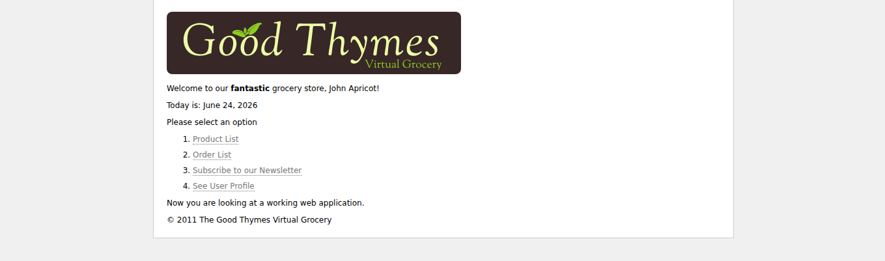
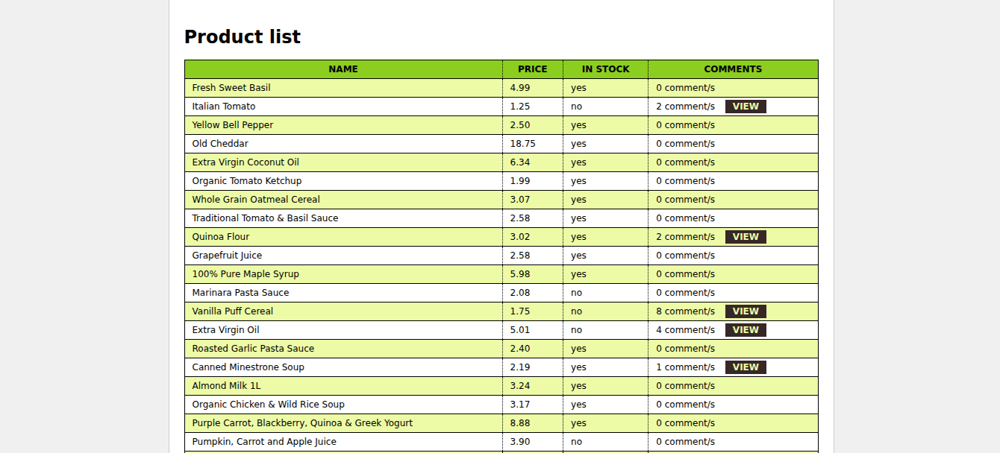
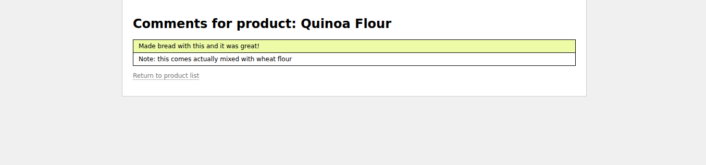
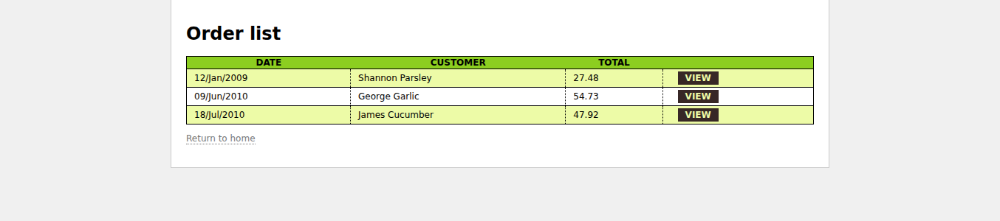
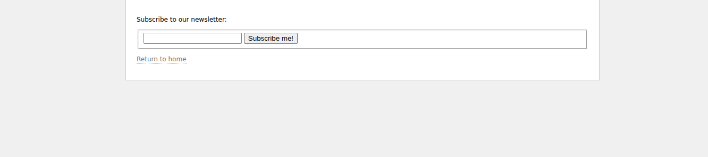
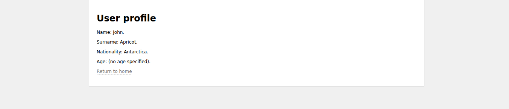

OK
Картинки см. в doc/
Java 11

````shell
run.sh
````

### Themleaf

````shell
mvn clean verify cargo:run
````

[http://127.0.0.1:8080/](http://127.0.0.1:8080/)

templates ? [src/main/webapp/WEB-INF/templates](src/main/webapp/WEB-INF/templates)








??????:

````java
        final OrderService orderService = new OrderService();
        final List<Order> allOrders = orderService.findAll();
        
        final WebContext ctx = new WebContext(webExchange, webExchange.getLocale());
        // allOrders - bean ??? ??????????? ?????? ???????
        // ? ??????? ????? ???????? ??? "orders"
        ctx.setVariable("orders", allOrders);
        
        templateEngine.process("order/list", ctx, writer);
````

"order/list" ?? [src/main/webapp/WEB-INF/templates/order/list.html](src/main/webapp/WEB-INF/templates/order/list.html)

?? ??????? "order/list" (??.???? - "...? ??????? ????? ???????? ??? "orders"..."):

````html
      <tr th:each="o : ${orders}" th:class="${oStat.odd}? 'odd'">
        <td th:text="${#calendars.format(o.date,'dd/MMM/yyyy')}">13 jan 2011</td>
        <td th:text="${o.customer.name}">Frederic Tomato</td>
        <td th:text="${#aggregates.sum(o.orderLines.{purchasePrice * amount})}">23.32</td>
        <td>
          <a href="details.html" th:href="@{/order/details(orderId=${o.id})}">view</a>
        </td>
      </tr>
````

