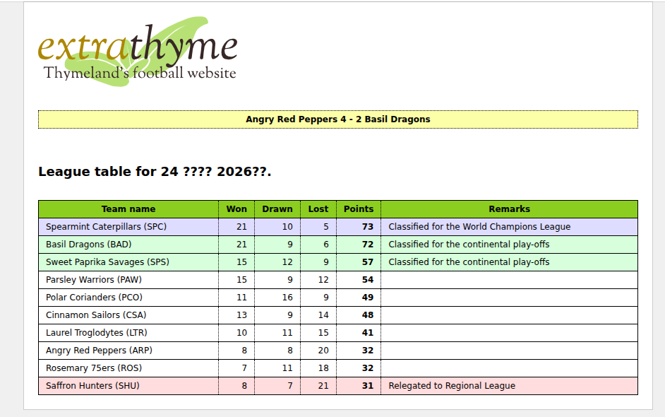

Spring Boot, Spring WebMVC.


This application can be run with:

```
$ mvn clean verify cargo:run
```

Open [http://localhost:8080](http://localhost:8080)



?????? ? [src/main/webapp/WEB-INF/templates/extrathyme.html](src/main/webapp/WEB-INF/templates/extrathyme.html)
This will start an Apache Tomcat container serving the web application in `http://localhost:8080`
