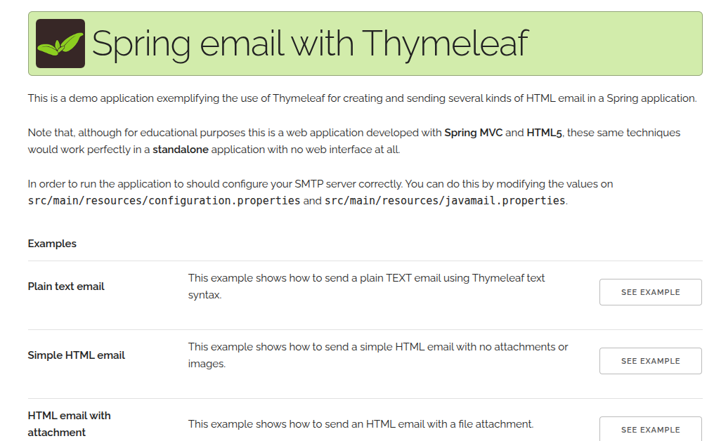
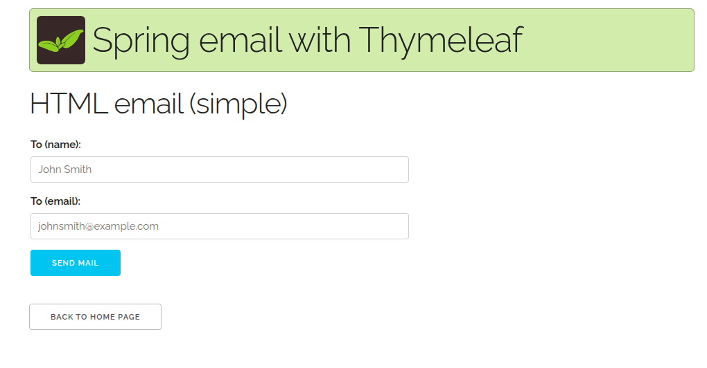
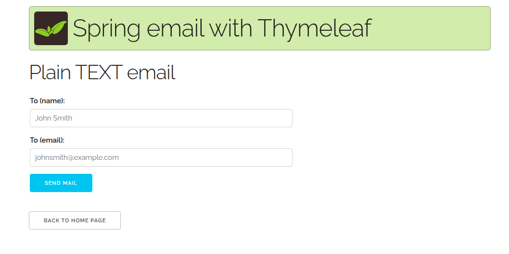
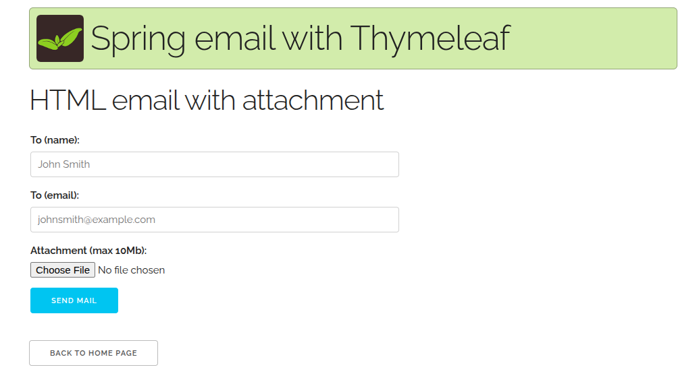
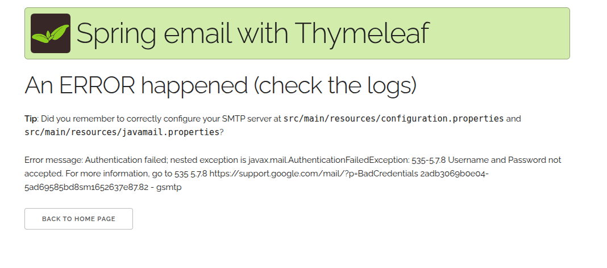

### Spring MVC + Themleaf

No SpringBOOT.

This application can be run with:

```
$ mvn clean verify cargo:run
```








This will start an Apache Tomcat container serving the web application in `http://localhost:8080`
