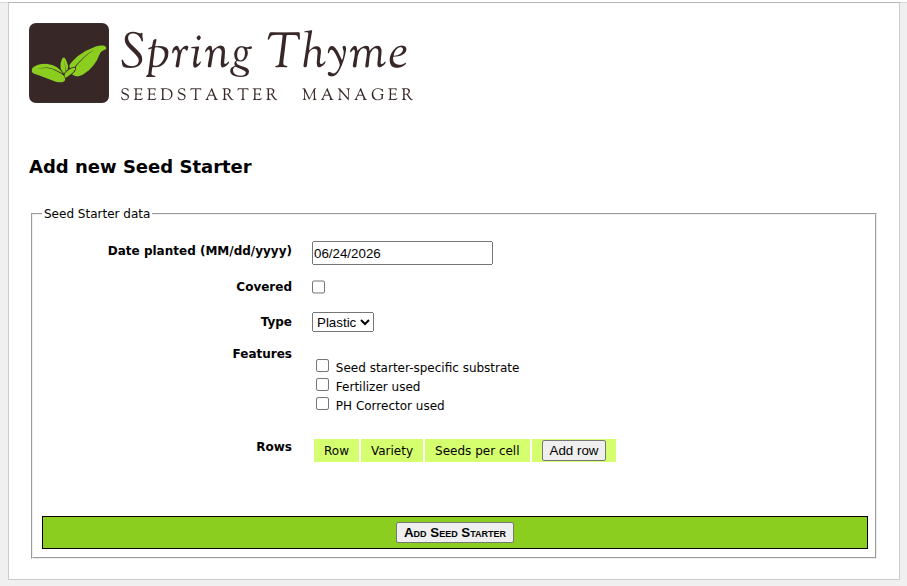
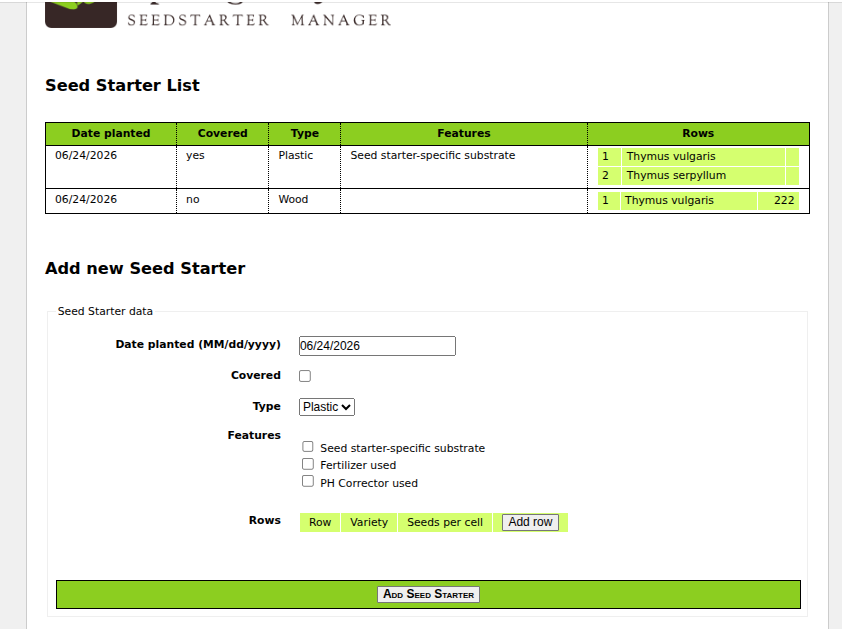

### CRUD Application with Thymeleaf Web UI 

Templates in [src/main/webapp/WEB-INF/templates](src/main/webapp/WEB-INF/templates).

Spring MVC. 
No Spring Boot.

stsm - Spring Thyme Seed Starter Manager


````xml
    <dependency>
      <groupId>org.springframework</groupId>
      <artifactId>spring-web</artifactId>
    </dependency>
    <dependency>
      <groupId>org.springframework</groupId>
      <artifactId>spring-webmvc
    </dependency>
````

This application can be run with:

```
$ mvn clean verify cargo:run
```

````shell
./run.sh
````




This will start an Apache Tomcat container serving the web application in `http://localhost:8080`
