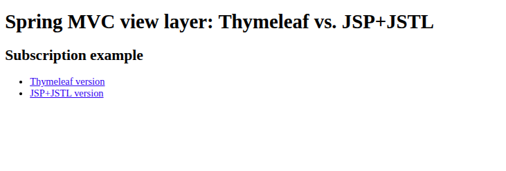
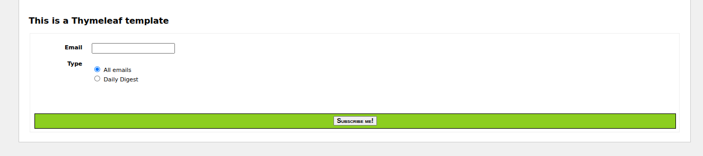
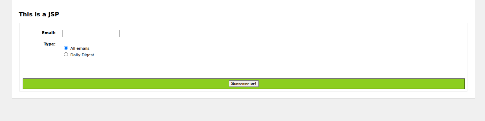

No Spring Boot.
War application.
Thymeleaf.


````shell
./run.sh
````






This application can be run with:

```
$ mvn clean verify cargo:run
```

This will start an Apache Tomcat container serving the web application in `http://localhost:8080`
