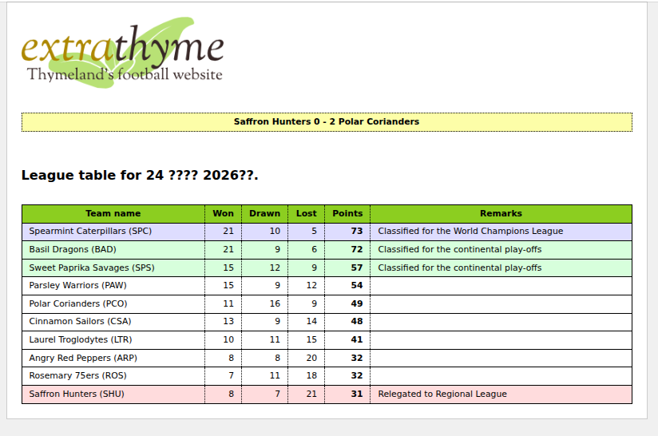

Web
Spring MVC
Java 21

Template in [src/main/webapp/WEB-INF/templates/extrathyme.html](src/main/webapp/WEB-INF/templates/extrathyme.html)

````
./run.sh
````

[http://127.0.0.1:8080/](http://127.0.0.1:8080/)



This application can be run with:

```
$ mvn clean verify cargo:run
```

This will start an Apache Tomcat container serving the web application in `http://localhost:8080`
