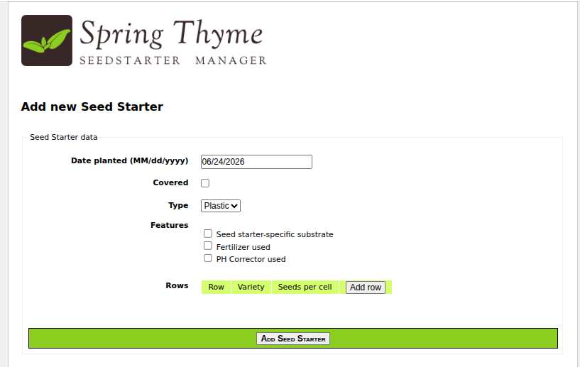
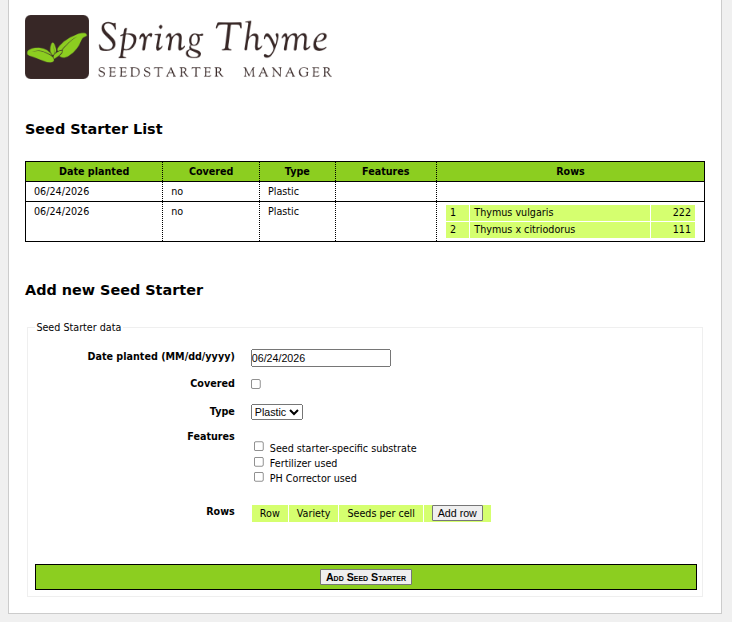

Tomcat 10, war, Java 17, Spring MVC, ThymeLeaf

````shell
./run.sh
````

[http://127.0.0.1:8080/](http://127.0.0.1:8080/)


This application can be run with:

```
$ mvn clean verify cargo:run
```




This will start an Apache Tomcat container serving the web application in `http://localhost:8080`
