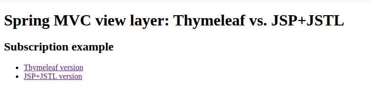
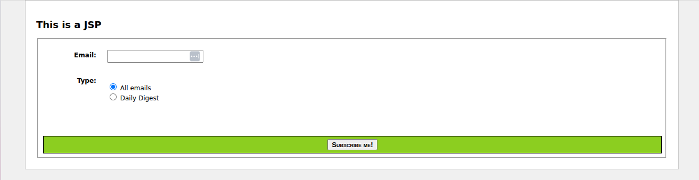

### Spring MVC, ThymeLeaf
War




JSP - ?? ?????????.

Spring 6 [../Readme.md](../Readme.md), ?.?. artifactId = thymeleaf-spring6

This application can be run with:

```
$ mvn clean verify cargo:run
```

This will start an Apache Tomcat container serving the web application in `http://localhost:8080`
