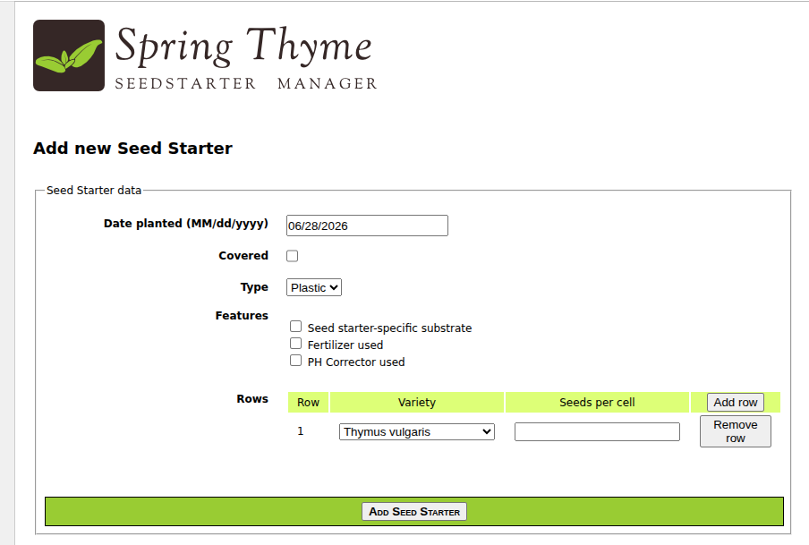
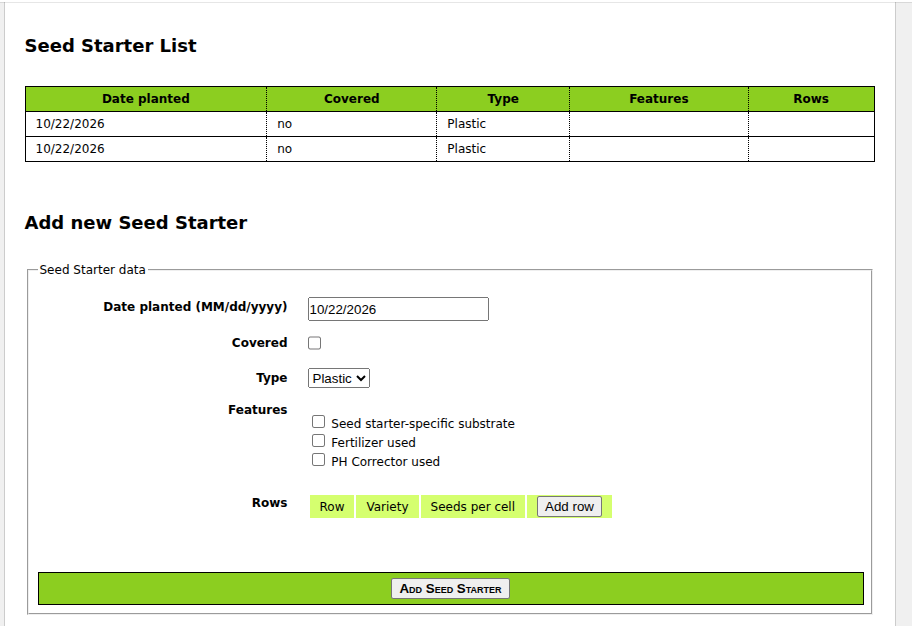

# Пример Thymeleaf, Spring Boot, Webflux

__WEBFLUX__!!! 

This application can be run with:

````shell
mvn clean compile spring-boot:run
````

````text
Starting StsmWebFluxApplication using Java 21
````




Доступ [http://localhost:8080](http://localhost:8080)

В Java:

См. __articles__:

````java
    @GetMapping
    public String allArticles(Model model) {
        model.addAttribute("articles", fetchArticles());
        return "articles-list";
    }
````

В шаблоне themleaf:

1 способ:
````html
<div th:each="article : ${articles}">
    <a th:text="${article.name}" th:href="${article.url}"></a>
</div>
````

2 способ:
````html
<div th:with="firstArticle=${articles[0]}">
    <a th:text="${firstArticle.name}" th:href="${firstArticle.url}"></a>
</div>
````

3 способ:
````html
<div th:each="article : ${articles}", th:with="articleName=${article.name}">
    <a th:text="${articleName}" th:href="${article.url}"></a>
</div>
````
----

Из статьи [Учебник Thymeleaf: Глава 4. Standard Expression Syntax](https://habr.com/ru/articles/350870/)

Themleaf expression language:

- Простые выражения:
    - Переменная: ${...}
    - Выбранная переменная: *{...}
    - Вычисляемое выражение со значением из $: #{...${...}...}
    - Ссылка URL: @{...}
    - Фрагмент: ~{...}
- Литералы/Literals:
    - Текст: 'one text', 'Another one!',...
    - Число: 0, 34, 3.0, 12.3,...
    - Boolean: true, false
    - Null: null
    - Токены: one, sometext, main,...
- Текст:
    - Соединение строк: +
    - Подстроки: |The name is ${name}|
- Арифметика:
    - Binary: +, -, *, /, %
    - Минус (unary operator): -
- Boolean:
    - Binary: and, or
    - Boolean отрицание (unary operator): !, not
- Сравнение и равенство:
    - Сравнение: >, <, >=, <= (gt, lt, ge, le)
    - Равенство: ==, != (eq, ne)
- Условные:
    - If-then: (if)? (then)
    - If-then-else: (if)? (then): (else)
    - Default: (value) ?: (defaultvalue)
- Специальные токены:
    - No-Operation: _

----

### Выражения:

````html
<p th:utext="#{home.welcome}">Welcome to our grocery store!</p>
````

----

### Выражение с переменной:

Определение в application.properties:

````html
home.welcome=Привет, {0}!
````

Использование в шаблоне (внимание на # и внутри #{...}):

````html
<p th:utext="#{home.welcome(${session.user.name})}">
  Welcome to our grocery store, Sebastian Pepper!
</p>
````
(шаблон берется из __application.properties__ по имени __'home.welcome'__. 
    И в него подставляется значение themleaf переменной __'session.user.name'__)

----

### Работа с объектом __'th:object'__ и ссылка на текущий контекст объекта __'*{}'__:

````html
<div th:object="${session.user}">
  <p>Name: <span th:text="*{firstName}">Sebastian</span>.</p>
  <p>Surname: <span th:text="*{lastName}">Pepper</span>.</p>
  <p>Nationality: <span th:text="*{nationality}">Saturn</span>.</p>
</div>
````

__*{firstName}__ это обращение к __session.user.firstName__.

или

Доступ к свойствам с использованием точки (.). Эквивалент вызывающим getter свойств:

````html 
${person.father.name}
````

или доступ к свойству может быть так же через скобки ([]) и написание имени свойства 
как переменной или между простыми кавычками.

````html
${person['father']['name']}
````

или, если объект является map (persons[String].getAge()), оба синтаксиса точки и скобки будет эквивалентен 
выполнению метода get(...):

````html
${persons['Stephen Zucchini'].age}
````

----

### Массивы.

Доступ к массиву или коллекции так же выполняется через скобки, с написанием индекса без скобок.

````html
${personsArray[0].name}
````

----

Могут быть вызваны методы (даже с аргументами):

````html
${person.createCompleteName()}
${person.createCompleteNameWithSeparator('-')}
````
----
### Ссылки

Внимание на __'@{...}'__:

````html
<!-- Создаем 'http://localhost:8080/gtvg/order/details?orderId=3' (плюс реврайт) -->
<a href="details.html" th:href="@{http://localhost:8080/gtvg/order/details(orderId=${o.id})}">view</a>

<!-- Создаем '/gtvg/order/details?orderId=3' (плюс реврайт, НЕТ  localhost) -->
<a href="details.html" th:href="@{/order/details(orderId=${o.id})}">view</a>

<!-- Создаем '/gtvg/order/3/details' (плюс реврайт) -->
<a href="details.html" th:href="@{/order/{orderId}/details(orderId=${o.id})}">view</a>
````

Если требуется несколько параметров, они должны быть разделены запятыми: 

````html
@{/order/process(execId=${execId},execType='FAST')}
````

Относительные URL-адреса, начинающиеся с / (например: /order/details), будут с автоматически префиксами в виде имени контекста приложения.

### Связь URL ссылок с шаблонами

````html
<p>Please select an option</p>
<ol>
  <li><a href="product/list.html" th:href="@{/product/list}">Product List</a></li>
  <li><a href="order/list.html" th:href="@{/order/list}">Order List</a></li>
  <li><a href="subscribe.html" th:href="@{/subscribe}">Subscribe to our Newsletter</a></li>
  <li><a href="userprofile.html" th:href="@{/userprofile}">See User Profile</a></li>
</ol>
````

Пояснение: в браузере http://localhost/product/list.html отобразится страница th:href="@{/product/list}".

И еще, как и в случае синтаксиса сообщения (#{...}), URL также могут быть результатом выполнения другого выражения:

````html
<a th:href="@{${url}(orderId=${o.id})}">Текст ссылки 1</a>
<a th:href="@{'/details/'+${user.login}(orderId=${o.id})}">Текст ссылки 2</a>
````

Ссылки URLs относительно __корневой__ директории сервера __"@{~/path/to/something}"__.
----

### Фрагменты

Для вставки фрагмента используется __th:insert__ (см.ниже) или __th:replace__ (в этом проекте нет).
(атрибут th:include устарел и с Thymeleaf 3.0 не рекомендуется):

- th:insert — вставляет содержимое фрагмента внутрь текущего тега.
- th:replace — заменяет текущий тег на тег, который определяет фрагмент.

Пример __th:insert__:

Из файла __commons.html__ вставляется фрагмент c именем __main__:

````html
<div th:insert="~{commons :: main}">
````

Определение фрагмента __main__ в файле __commons.html__:

````html
<div th:fragment="main">
    &copy; 2025 My Site
</div>
````
(&copy; - знак копирайта)

Разница между __th:insert__, __th:replace__, __th:include__:

````html
<footer th:fragment="copy">
  The Good Thymes Virtual Grocery
</footer>

<body>
  <div th:insert="footer :: copy"></div>
  <div th:replace="footer :: copy"></div>
  <div th:include="footer :: copy"></div>
</body>
````

выдаст результат:

````html
<body>
  ...
  <!-- th:insert="footer :: copy". footer ВСТАВЛЕН в div -->
  <div>
    <footer>
      The Good Thymes Virtual Grocery
    </footer>
  </div>

  <!-- th:replace="footer :: copy". footer ЗАМЕНИЛ div -->
  <footer>
    The Good Thymes Virtual Grocery
  </footer>

  <!-- th:include="footer :: copy". СОДЕРЖИМОЕ из footer ВСТАВЛЕНО в div -->
  <div>
    The Good Thymes Virtual Grocery
  </div>
 
</body>
````

### Параметризируемые фрагменты

__th:fragment__ может принимать __параметры__:

Фрагмент "frag1":

````html
<div th:fragment="frag1 (one_var,two_var)">
    <p th:text="${one_var} + ' - ' + ${two_var}">...</p>
</div>
````

внимание на __frag1__.

Использование:

````html
<div th:replace="::frag1 (${value1},${value2})">...</div>
<div th:replace="::frag1 (one_var=${value1},two_var=${value2})">...</div>
````

(порядок не важен в последнем варианте)

Даже если фрагменты определены без аргументов:

````html
<div th:fragment="frag1"> // вместо th:fragment="frag1 (one_var,two_var)
  <p th:text="${one_var} + ' - ' + ${two_var}">...</p>
</div>
````

можно использовать:

````html
<div th:replace="::frag1 (onevar=${value1},twovar=${value2})">
````
(::frag1 - вставка фрагмента с именем "frag1")

Это будет эквивалентно сочетанию __th:replace__ и __th:with__:

````html
<div th:replace="::frag" th:with="onevar=${value1},twovar=${value2}">
````

### block

Фрагмент:

````html
<head th:fragment="common_header(title,links)">
  <title th:replace="${title}">The awesome application</title>
  <!-- Common styles and scripts -->
  <link rel="stylesheet" type="text/css" media="all" th:href="@{/css/awesomeapp.css}">
  <link rel="shortcut icon" th:href="@{/images/favicon.ico}">
  <script type="text/javascript" th:src="@{/sh/scripts/codebase.js}"></script>

  <!--/* Per-page placeholder for additional links */-->
  <th:block th:replace="${links}" />
</head>
````

Использование:
````html
<head th:replace="base :: common_header(~{::title},~{::link})">
  <title>Awesome - Main</title>
  <link rel="stylesheet" th:href="@{/css/bootstrap.min.css}">
  <link rel="stylesheet" th:href="@{/themes/smoothness/jquery-ui.css}">
</head>
````

Результат:

````html
<head>
  <title>Awesome - Main</title>
  <!-- Common styles and scripts -->
  <link rel="stylesheet" type="text/css" media="all" href="/awe/css/awesomeapp.css">
  <link rel="shortcut icon" href="/awe/images/favicon.ico">
  <script type="text/javascript" src="/awe/sh/scripts/codebase.js"></script>

  <link rel="stylesheet" href="/awe/css/bootstrap.min.css">
  <link rel="stylesheet" href="/awe/themes/smoothness/jquery-ui.css">
</head>

````

### Условная вставка

Фрагмент вставляется только в том случае, если пользователь является администратором, 
и не вставлять ничего (emtpy фрагмент), если нет.

````html
<div th:insert="${user.isAdmin()} ? ~{common :: adminhead} : ~{}">...</div>
````

Можно использовать "no-operation" токен ('_'),  чтобы вставить фрагмент, 
только если указанное условие выполнено, но оставить разметку без изменений, 
если условие не выполнено:

````html
<div th:insert="${user.isAdmin()} ? ~{common :: adminhead} : _">
    Welcome [[${user.name}]], click <a th:href="@{/support}">here</a> for help-desk support.
</div>
````

