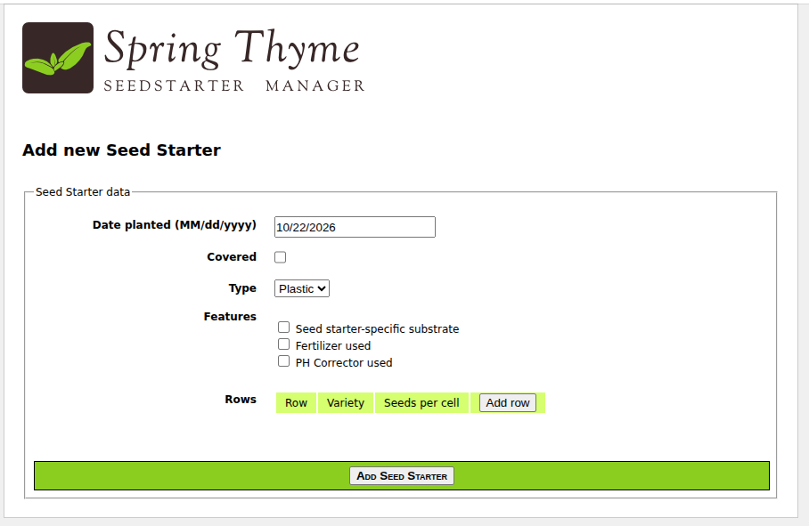
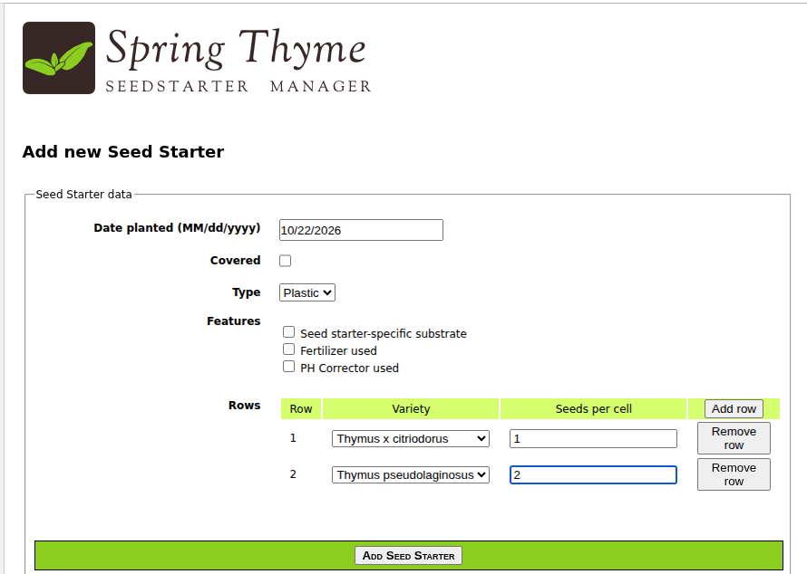
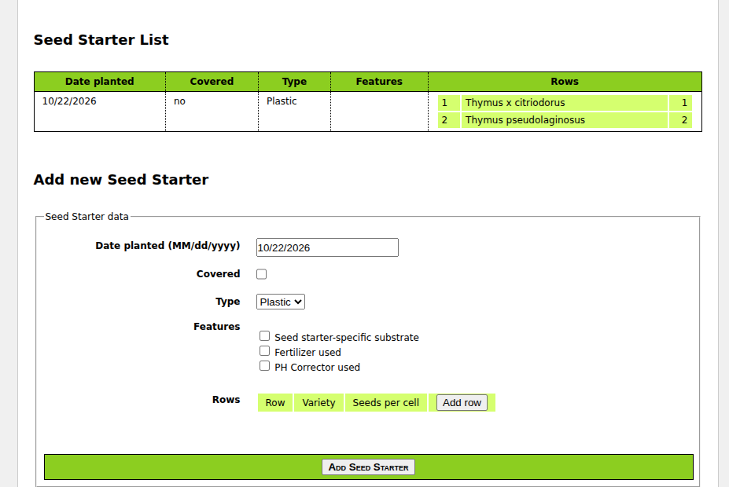
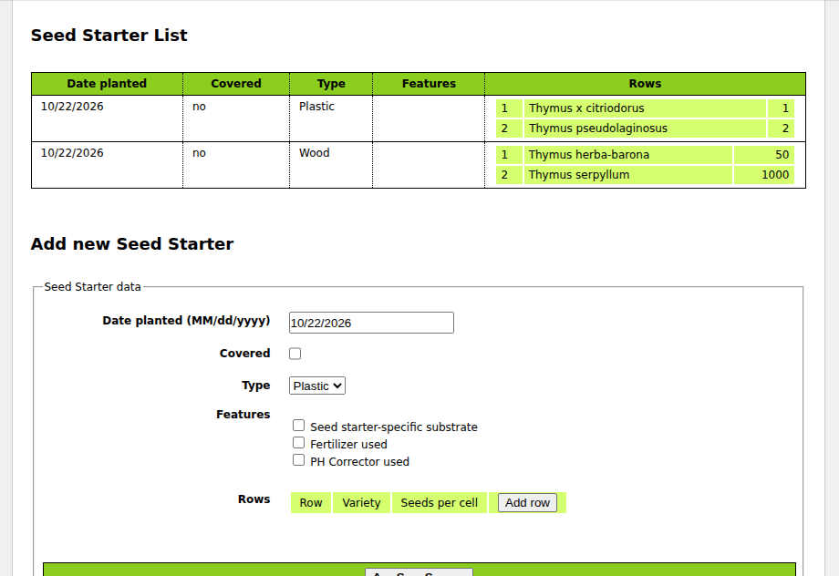

Spring Boot, ThymeLeaf, WebFlux






````shell
./run.sh
````

See main in 

This application can be run with:

```
$ mvn clean compile spring-boot:run
```

This will start a web container serving the web application in `http://localhost:8080`
